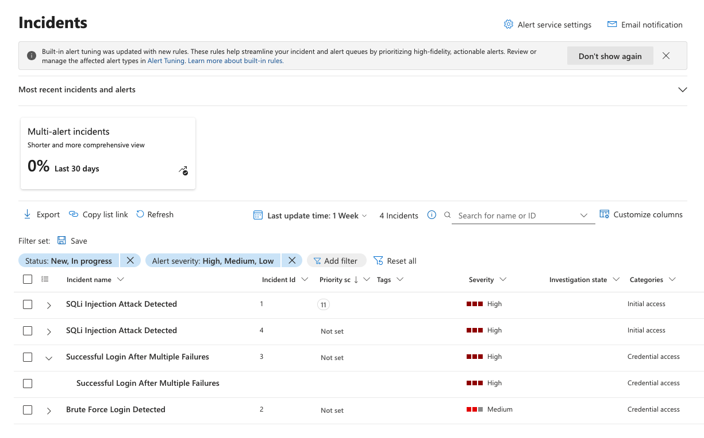
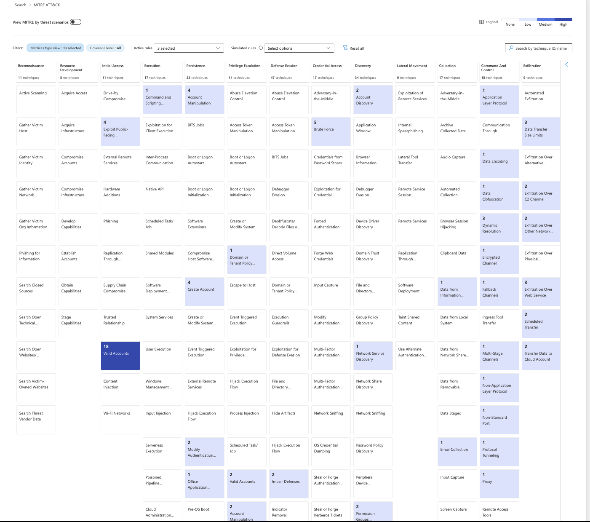
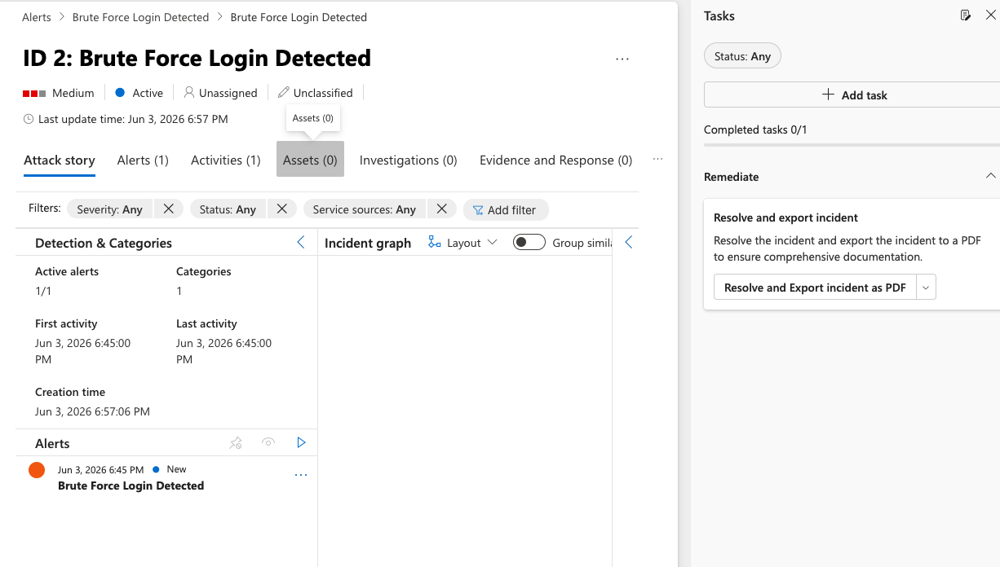
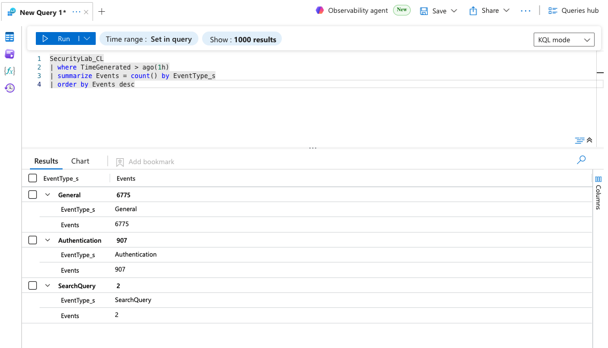

# Sentinel SOC Lab


A fully containerised **offensive/defensive security lab** that generates realistic attack telemetry — SQL injection, brute force, port scanning, RCE — and forwards it to **Microsoft Sentinel** for SIEM detection, KQL analytics, and incident response practice. Everything runs locally on a single Mac with Docker. Only Sentinel lives in Azure.

---

## Screenshots

### Incidents Dashboard


### SQL Injection Detection


### Brute Force Detection


### KQL Query Results


### MITRE ATT&CK Coverage


---

## Overview

This lab simulates a real-world SOC pipeline end-to-end:

```
Kali Attacker ──► Vulnerable PHP App ──► Syslog Collector ──► Microsoft Sentinel
  (offensive)         (target)             (log pipeline)        (SIEM/detection)
```

---

## Architecture

```
┌─────────────────────────────────────────────────────────────────┐
│                          macOS Host                             │
│                                                                 │
│  ┌───────────────────────────────────────────────────────────┐  │
│  │              Docker Network  172.20.0.0/24                │  │
│  │                                                           │  │
│  │  ┌─────────────┐   ┌─────────────┐   ┌───────────────┐  │  │
│  │  │  MySQL DB   │   │  Webapp     │   │ Kali Attacker │  │  │
│  │  │ 172.20.0.5  │   │ 172.20.0.10 │   │ 172.20.0.20   │  │  │
│  │  │ Port: 3306  │◄──│ Port: 8888  │◄──│ sqlmap/nmap/  │  │  │
│  │  └─────────────┘   └──────┬──────┘   │ hydra/nikto   │  │  │
│  │                           │          └───────────────┘  │  │
│  │                    syslog │ UDP 514                      │  │
│  │                    ┌──────▼──────────┐                   │  │
│  │                    │ Syslog Collector│                   │  │
│  │                    │  172.20.0.30   │                   │  │
│  │                    │  rsyslog +     │                   │  │
│  │                    │  Python fwdr   │                   │  │
│  │                    └──────┬─────────┘                   │  │
│  └───────────────────────────┼───────────────────────────────┘  │
│                              │ HTTPS / HTTP Data Collector API  │
└──────────────────────────────┼──────────────────────────────────┘
                               ▼
                  ┌────────────────────────┐
                  │   Microsoft Sentinel   │
                  │  Log Analytics WS      │
                  │  KQL Analytics Rules   │
                  │  Incidents & Alerts    │
                  └────────────────────────┘
```

| Container | Image | IP | Ports | Role |
|---|---|---|---|---|
| `mysql-db` | `mysql:8.0` | `172.20.0.5` | `3306` | Vulnerable database |
| `webapp` | `php:8.1-apache` | `172.20.0.10` | `8888→80` | Intentionally vulnerable PHP app |
| `syslog-collector` | `ubuntu:22.04` | `172.20.0.30` | `514/udp+tcp` | Rsyslog + Azure forwarder |
| `kali-attacker` | `kalilinux/kali-rolling` | `172.20.0.20` | — | Attack tooling |

---

## Attack Scenarios

| Attack | Tool | Target | Log Generated |
|---|---|---|---|
| SQL Injection — auth bypass | Manual / sqlmap | `/login.php` | `LOGIN_ATTEMPT` with raw SQL query |
| SQL Injection — union-based | Manual / sqlmap | `/search.php` | `SEARCH_QUERY` with payload |
| Brute Force | Hydra | login page | `LOGIN_FAILED` × N |
| Port Scanning | Nmap | webapp | Network events |
| Web Vulnerability Scan | Nikto / Gobuster | webapp | Access logs |
| RCE via File Upload | Manual | `/upload.php` | `FILE_UPLOAD` event |

---

## Analytics Rules

5 detection rules built in Microsoft Sentinel (Defender Portal), all mapped to MITRE ATT&CK:

| Rule | Severity | Tactics | Techniques |
|---|---|---|---|
| SQL Injection Attack Detected | High | Initial Access, Credential Access | T1190, T1110.001 |
| Brute Force Login Detected | Medium | Credential Access | T1110, T1110.001 |
| Successful Login After Multiple Failures | High | Credential Access, Initial Access | T1110.001, T1078 |
| SQL Injection in Search Query | High | Initial Access, Collection | T1190, T1005 |
| Suspicious File Upload — Possible RCE | High | Initial Access, Execution, Persistence | T1190, T1059, T1505.003 |

---

## Prerequisites

- **macOS** with [Docker Desktop](https://www.docker.com/products/docker-desktop/) installed and running
- **Azure account** — free tier works ([Azure for Students](https://azure.microsoft.com/en-us/free/students/) gives $100 credit)
- ~5 GB free disk space
- Ports `8888`, `514`, `3306` free on the host

---

## Quick Start

```bash
# 1. Clone the repo
git clone https://github.com/luisantoniio1998/sentinel-soc-lab.git
cd sentinel-soc-lab

# 2. Add your Azure credentials
cp .env.example .env
# Edit .env — add your Workspace ID and Primary Key

# 3. Build and run
docker compose build
docker compose up -d

# 4. Verify
docker compose ps
open http://localhost:8888
```

> First build takes ~10–15 min (Kali image is large). Subsequent starts are instant.

---

## Azure Sentinel Setup

### 1 — Create Resources

| Step | Where | Action |
|---|---|---|
| 1 | [portal.azure.com](https://portal.azure.com) | Create Resource Group `rg-sentinel-lab` |
| 2 | Log Analytics Workspaces | Create workspace `law-sentinel-lab` |
| 3 | Microsoft Sentinel | Add `law-sentinel-lab` as workspace |

### 2 — Get Credentials

```bash
brew install azure-cli

az login

az monitor log-analytics workspace get-shared-keys \
  --resource-group rg-sentinel-lab \
  --workspace-name law-sentinel-lab \
  --query primarySharedKey -o tsv
```

Workspace ID is on the workspace **Overview** page.

### 3 — Configure .env

```bash
cp .env.example .env
```

```env
WORKSPACE_ID=xxxxxxxx-xxxx-xxxx-xxxx-xxxxxxxxxxxx
WORKSPACE_KEY=your+primary+key+here==
```

### 4 — Start the Lab

```bash
docker compose build syslog
docker compose up -d
```

Logs appear in Sentinel under `SecurityLab_CL` within 3–5 minutes.

### 5 — Create Analytics Rules

Analytics rules are managed in the **Microsoft Defender Portal** (`security.microsoft.com`):

1. Connect your `law-sentinel-lab` workspace to the Defender portal
2. Go to **Microsoft Sentinel → Analytics → + Create → Scheduled query rule**
3. Create the 5 rules from the [KQL Detection Rules](#kql-detection-rules) section below
4. On the **Incident settings** tab of each rule, enable **"Create incidents from alerts"**
5. Set MITRE mappings per the [Analytics Rules](#analytics-rules) table above

---

## Running Attacks

### All Scripts at Once

```bash
docker exec kali-attacker bash -c "cd /root/scripts && chmod +x *.sh && ./sql-injection.sh" &
docker exec kali-attacker bash -c "cd /root/scripts && ./bruteforce.sh" &
docker exec kali-attacker bash -c "cd /root/scripts && ./portscan.sh" &
docker exec kali-attacker bash -c "cd /root/scripts && ./web-scan.sh" &
```

### Individual Scripts

```bash
docker exec -it kali-attacker /bin/bash
cd /root/scripts

./sql-injection.sh   # SQLi payloads + automated sqlmap
./portscan.sh        # Nmap SYN, comprehensive, aggressive
./web-scan.sh        # Nikto + gobuster directory enum
./bruteforce.sh      # Hydra SSH brute force
```

### Manual SQLi Payloads — `http://localhost:8888`

```sql
-- Auth bypass
admin' OR '1'='1'--

-- Dump all users via UNION
admin' UNION SELECT null,username,password,null,null FROM users--

-- Time-based blind (5s delay confirms vulnerability)
admin' AND SLEEP(5)--
```

### Watch Events Flow in Real Time

```bash
# Structured auth events
docker exec syslog-collector tail -f /var/log/collect/webapp/auth.log

# Azure forwarder (confirms HTTP 200 sends to Sentinel)
docker logs -f syslog-collector
```

---

## KQL Detection Rules

Paste into **Sentinel → Logs** to query `SecurityLab_CL` directly, or use as analytics rule queries.

### 1 — SQL Injection Attack

```kql
SecurityLab_CL
| where EventType_s == "Authentication"
| where RawMessage_s matches regex @"('|--|UNION|SELECT|OR\s+'1'='1|SLEEP\()"
| extend
    IP = extract(@"IP=([^\s|]+)", 1, RawMessage_s),
    User = extract(@"User=([^\s|]+)", 1, RawMessage_s),
    Query = extract(@"Query=(.+?)(\||\s*$)", 1, RawMessage_s)
| project TimeGenerated, IP, User, Query
| order by TimeGenerated desc
```

### 2 — Brute Force Login

```kql
SecurityLab_CL
| where RawMessage_s contains "LOGIN_FAILED"
| extend IP = extract(@"IP=([^\s|]+)", 1, RawMessage_s)
| summarize FailedAttempts = count() by IP, bin(TimeGenerated, 5m)
| where FailedAttempts >= 5
```

### 3 — Successful Login After Multiple Failures

```kql
let failures =
    SecurityLab_CL
    | where RawMessage_s contains "LOGIN_FAILED"
    | extend IP = extract(@"IP=([^\s|]+)", 1, RawMessage_s)
    | summarize FailCount = count() by IP;
SecurityLab_CL
| where RawMessage_s contains "LOGIN_SUCCESS"
| extend IP = extract(@"IP=([^\s|]+)", 1, RawMessage_s)
| join kind=inner failures on IP
| where FailCount >= 3
| project TimeGenerated, IP, FailCount, RawMessage_s
```

### 4 — SQL Injection in Search

```kql
SecurityLab_CL
| where EventType_s == "SearchQuery"
| where RawMessage_s matches regex @"(UNION|SELECT|'|--|;|xp_|0x)"
| extend
    IP = extract(@"IP=([^\s|]+)", 1, RawMessage_s),
    Query = extract(@"Query=(.+)", 1, RawMessage_s)
| project TimeGenerated, IP, Query
```

### 5 — Suspicious File Upload

```kql
SecurityLab_CL
| where EventType_s == "FileUpload"
| where RawMessage_s contains "FILE_UPLOAD"
| extend
    IP = extract(@"IP=([^\s|]+)", 1, RawMessage_s),
    File = extract(@"File=([^\s|]+)", 1, RawMessage_s)
| project TimeGenerated, IP, File, RawMessage_s
```

### Attack Summary by Type

```kql
SecurityLab_CL
| where TimeGenerated > ago(1h)
| summarize Events = count() by EventType_s
| order by Events desc
```

---

## Log Flow

```
PHP app  ──UDP 514──►  rsyslog  ──►  /var/log/collect/webapp/auth.log
                                  ──►  /var/log/collect/webapp/all.log
                                  ──►  /var/log/collect/attacks/all.log
                          │
                    forwarder.py
                          │
                    HTTPS POST
                          │
                    Azure HTTP Data Collector API
                          │
                    SecurityLab_CL  ──►  Microsoft Sentinel
```

---

## Project Structure

```
sentinel-soc-lab/
├── README.md
├── docker-compose.yml
├── .env.example
├── .gitignore
├── LICENSE
├── webapp/
│   ├── Dockerfile
│   ├── init.sql
│   └── app/
│       ├── config.php          ← DB config + log_to_syslog()
│       ├── login.php           ← SQLi-vulnerable login
│       ├── search.php          ← SQLi-vulnerable search
│       ├── upload.php          ← RCE-vulnerable file upload
│       ├── dashboard.php
│       ├── index.php
│       ├── info.php            ← phpinfo() info disclosure
│       └── logout.php
├── attacker/
│   ├── Dockerfile
│   └── scripts/
│       ├── sql-injection.sh
│       ├── bruteforce.sh
│       ├── portscan.sh
│       └── web-scan.sh
├── syslog-collector/
│   ├── Dockerfile
│   ├── rsyslog.conf            ← routes logs by tag/content
│   ├── forwarder.py            ← tails logs, POSTs to Azure HTTP API
│   └── entrypoint.sh          ← starts rsyslog + forwarder
├── configs/
│   └── azure/
│       └── dcr-config.json
├── docs/
│   └── azure-setup.md
└── images/
    ├── incidents.png
    ├── sqlinjection.png
    ├── bruteforce.png
    ├── logs.png
    └── mitre_mapping.png
```

---

## Useful Commands

```bash
# Start / stop
docker compose up -d
docker compose down

# Shell into any container
docker exec -it kali-attacker /bin/bash
docker exec -it webapp /bin/bash
docker exec -it syslog-collector /bin/bash

# Live log monitoring
docker exec syslog-collector tail -f /var/log/collect/webapp/auth.log
docker logs -f syslog-collector

# Check MySQL login attempts table
docker exec mysql-db mysql -u webapp -pwebapp123 webapp_db \
  -e "SELECT username, ip_address, success, timestamp FROM login_attempts ORDER BY timestamp DESC LIMIT 20;"

# Full clean reset
docker compose down -v --rmi local
```

---

## Troubleshooting

| Problem | Fix |
|---|---|
| Webapp doesn't start | Check `syslog-collector` is healthy: `docker compose ps` |
| No logs in Sentinel | Check forwarder: `docker logs syslog-collector` — should show `HTTP 200` |
| rsyslog fails on restart | Fixed — entrypoint removes stale PID file automatically |
| Port conflict on 8888 | Change `"8888:80"` in `docker-compose.yml` to any free port |
| Kali build is slow | ~3 GB image — only on first build |
| Analytics in Sentinel | Moved to Defender portal (`security.microsoft.com`) — connect workspace there |
| Alerts but no incidents | Edit each rule → Incident settings → enable "Create incidents from alerts" |
| `.env` not found | `cp .env.example .env` and fill in your credentials |

---

## Disclaimer

> This lab contains **intentionally vulnerable software** for educational and research purposes only.
> Do **not** expose any service to the public internet.
> All credentials are hardcoded by design — never reuse them outside this lab.

---

## License

MIT — see [LICENSE](LICENSE) for details.
